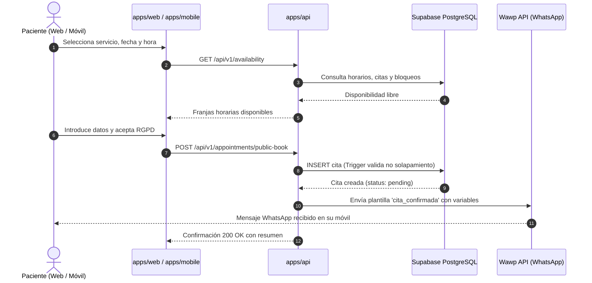

# 🏥 Arquitectura del Sistema - Clínica Dental Eugenia

Sistema integral de gestión de citas médicas, pacientes, agenda interactiva y mensajería automatizada por WhatsApp (Wawp) para **Clínica Dental Eugenia**.

---

## 🚫 Principio Fundamental: Cero Módulos Económicos

Por definición estricta de alcance, la arquitectura excluye de raíz:
- Pasarelas de pago (Stripe, Redsys, PayPal, etc.)
- Facturación, presupuestos, precios, importes, prepagos o cobros
- Cupones, descuentos, carritos, pedidos o reembolsos
- Cualquier tabla, campo numérico monetario o indicador financiero

El sistema está enfocado al 100% en la **excelencia médica, agendamiento inteligente, reducción del absentismo y cumplimiento estricto del RGPD**.

---

## 🏗️ Estructura del Monorepo

```
.
├── apps/
│   ├── web/           # Frontend React + Vite + TypeScript + Tailwind + FullCalendar
│   ├── api/           # Backend Node.js + Express + TypeScript modular
│   └── mobile/        # App móvil React Native con Expo
├── packages/
│   ├── shared/        # Tipos TypeScript, validaciones Zod y constantes comunes
│   └── ui/            # Componentes compartidos
├── supabase/
│   ├── migrations/    # Migraciones SQL versionadas (RLS, Triggers, Funciones)
│   └── seed/          # Datos maestros y clínicas de prueba
└── docs/              # Documentación técnica de arquitectura, BD, Wawp y despliegue
```

---

## 🧩 Módulos del Backend (`apps/api`)

1. **Appointments (`appointments`)**:
   - Creación, modificación, cancelación y reprogramación de citas.
   - Prevención estricta de solapamientos médicos mediante triggers PostgreSQL (`check_appointment_overlap`).
   - Sincronización de eventos de FullCalendar (`eventDrop`, `eventResize`).

2. **Availability Engine (`availability`)**:
   - Cálculo en tiempo real de intervalos disponibles cruzando:
     - Horario general de apertura de la clínica y días cerrados.
     - Horario laboral de cada odontólogo y descansos.
     - Citas ya existentes (evita solapamientos).
     - Bloqueos de agenda, vacaciones y festivos.
     - Margen de desinfección / buffer entre citas (ej. 10 minutos).

3. **Wawp WhatsApp Gateway (`wawp`)**:
   - Integración oficial con la API de Wawp ([https://wawp.net/en](https://wawp.net/en)).
   - Envío de mensajes y plantillas con variables dinámicas (`{{nombre}}`, `{{fecha}}`, `{{hora}}`, `{{profesional}}`, `{{servicio}}`).
   - Modo Sandbox con simulador visual integrado en consola para desarrollo local sin consumo de cuotas.
   - Idempotencia y gestión de reintentos.

4. **Webhooks (`webhooks`)**:
   - Recepción de mensajes entrantes de pacientes y confirmaciones de entrega/lectura.
   - Lógica de auto-confirmación de citas: cuando un paciente responde "SÍ" o "CONFIRMAR", la cita pasa automáticamente a estado `confirmed`.

5. **Patients & Medical Records (`patients`)**:
   - CRUD de pacientes, antecedentes, alergias conocidas, medicación habitual.
   - Cumplimiento RGPD: consentimientos informados y derecho de supresión / anonimización inmediata.

6. **Schedules & Operating Hours (`schedules`)**:
   - Endpoint público `/api/v1/schedules/public` para renderizado dinámico en la web.
   - Horarios específicos por profesional y por gabinete/consultorio.
   - Bloqueos de agenda con motivo.

7. **Automated Reminders (`reminders`)**:
   - Cron runner periódico que busca citas próximas a 24 horas y 2 horas.
   - Despacho automático de recordatorios por WhatsApp evitando duplicidades.

---

## 🔄 Flujo de Reserva y Mensajería Wawp



