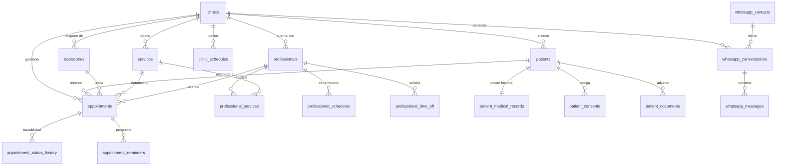

# 🗄️ Modelo de Datos - Clínica Dental Eugenia (Supabase / PostgreSQL)

Modelo relacional médico optimizado para PostgreSQL 17 en Supabase con Row Level Security (RLS) y triggers de integridad clínica.

---

## 🚫 Garantía de Alcance: Cero Datos Económicos
Ninguna tabla ni columna contiene importes, precios, tarifas, números de tarjeta, facturas ni transacciones monetarias.

---

## 📊 Diagrama Entidad-Relación

---

## 📋 Detalle de Tablas Principales

### 1. `clinics`
Datos de la clínica: denominación, CIF, teléfonos (general y urgencias), dirección en Madrid, zona horaria y estado activo.

### 2. `services`
Tratamientos odontológicos: nombre, slug, categoría médica, descripción clínica, beneficios, duración en minutos, color de bloque en calendario, icono y visibilidad pública.

### 3. `professionals`
Odontólogos y cirujanos: nombre, número de colegiado oficial, especialidad, idiomas, color identificador en calendario y gabinete por defecto.

### 4. `operatories`
Salas de atención y gabinetes clínicos (ej. "Gabinete 1 - Diagnóstico", "Gabinete 3 - Quirófano").

### 5. `clinic_schedules` & `professional_schedules`
Horario semanal general de la clínica y turnos propios de cada doctor (días 0-6, apertura, cierre, pausas de comida).

### 6. `blocked_slots`
Festivos locales, mantenimiento de sillones dentales o pausas clínicas con motivo.

### 7. `patients` & `patient_medical_records`
Expedientes de pacientes con datos de contacto, alergias medicamentosas, patologías de riesgo (hipertensión, diabetes), medicación habitual y notas clínicas.

### 8. `patient_consents`
Registro de consentimientos RGPD con tipo (tratamiento, WhatsApp, recordatorios), versión de política, fecha, IP y agente de usuario.

### 9. `appointments`
Citas médicas con: paciente, profesional, gabinete, servicio, fecha/hora inicio y fin, estado (`pending`, `confirmed`, `in_waiting_room`, `completed`, `cancelled_by_patient`, `cancelled_by_clinic`, `no_show`), notas y motivos de cambio.

### 10. `whatsapp_conversations` & `whatsapp_messages`
Bandeja de mensajes de WhatsApp sincronizados mediante Wawp, con dirección (entrante/saliente), estados (enviado, entregado, leído) y vinculación con expedientes de pacientes.

---

## 🛡️ Trigger de Prevención de Solapamientos

La función `check_appointment_overlap()` en PostgreSQL evalúa antes de cada `INSERT` o `UPDATE`:
1. Que el odontólogo no tenga otra cita simultánea no cancelada.
2. Que el gabinete médico no esté ocupado por otro profesional a la misma hora.
3. Que no coincida con un bloqueo de agenda o festivo cerrado.

Si se detecta solapamiento, la base de datos aborta la transacción con el error específico `23P01` (`CONFLICT_PROFESSIONAL` o `CONFLICT_OPERATORY`).

