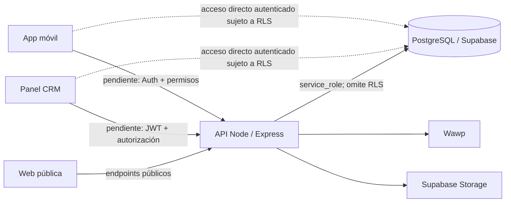

# Seguridad y despliegue de Clínica Dental Eugenia

## Estado

La migración `20261119170940_security_hardening.sql` endurece el esquema existente. Alinea políticas y permisos con las tablas que ya usa la aplicación; no crea las tablas propuestas en el documento de requisitos que no existen en este repositorio (`rooms`, `user_roles`, `schedule_exceptions`, etc.).

**El sistema todavía no cumple el criterio de producción.** Las rutas CRM de Express usan `service_role` sin `requireAuth`; `service_role` omite RLS. La web y la app móvil tampoco tienen flujo de autenticación. El webhook es la excepción: valida un secreto dedicado e inserta el identificador del evento para deduplicar, pero su procesamiento aún es síncrono. Hasta integrar JWT y autorización por permiso en las rutas CRM, RLS no puede proteger las peticiones que pasan por el backend.

### Actualización (19-11-2026)

- **Migraciones aplicadas en la base de la app (`localhost:8000`):** `20261119140000_secure_patient_consents` y `20261119170940_security_hardening` (estaban sin aplicar), y la nueva `20261119230000_crm_credentials`. La clave `anon` ya no puede leer ninguna tabla de la aplicación y la auditoría (`audit_logs`) está activa.
- **Acceso al CRM con usuario y contraseña:** toda la API bajo `/api` exige sesión salvo las rutas públicas de la web (servicios, profesionales, horario público, disponibilidad, reserva pública), `health`, `auth/login|logout|me` y los webhooks de Wawp (que validan su propio secreto).
  - Credenciales válidas: el usuario guardado en `crm_credentials` (se configura en *Configuración → Acceso al Panel*; contraseña con hash scrypt) y el superusuario de `.env` (`SUPER_USER` / `SUPER_PASS`).
  - Sesión: cookie `crm_session` HttpOnly, SameSite=Lax, `Secure` en producción, 12 h. Firmada con `CRM_SESSION_SECRET` (o derivada de `JWT_SECRET`). Cambiar la contraseña invalida las sesiones anteriores.
  - Login limitado a 10 intentos fallidos por IP cada 15 minutos.
- **Pendiente:** la app móvil (`apps/mobile`) usa `GET /appointments` y `PATCH /appointments/:id/status`, que ahora exigen sesión; necesita su propio flujo de acceso. Los roles (`profiles`, `roles`) aún no se usan para limitar qué puede hacer cada usuario del panel.

## Arquitectura y límites



El webhook acepta `/api/wawp/webhook` (y mantiene `/api/v1/whatsapp/webhook` por compatibilidad). Comprueba `WAWP_WEBHOOK_SECRET` en `X-Wawp-Signature` (también admite `x-wawp-secret` y `?secret=` para compatibilidad) y deduplica por ID de evento. Configura el secreto en el campo HMAC del panel de Wawp y usa HTTPS. Wawp documenta `/v2/send/text` con `instance_id`, `access_token`, `chatId` y `message`; la integración usa el adaptador servidor y el modo sandbox local. Usa un número de prueba de Wawp.

## Mapa del esquema actual

- `clinics` contiene la clínica; `profiles` enlaza usuarios Auth con `clinic_id` y `role_id`.
- `roles`, `permissions` y `role_permissions` definen el RBAC actual. Los roles son globales; no existe `user_roles`.
- `patients` enlaza con `patient_medical_records`, `patient_consents`, `patient_documents` y `appointments`.
- `professionals` enlaza con `professional_services`, `professional_schedules` y `professional_time_off`.
- `appointments` enlaza pacientes, profesionales, `operatories` y `services`; el historial y los recordatorios cuelgan de la cita.
- Las tablas `whatsapp_contacts`, `whatsapp_conversations`, `whatsapp_messages`, `message_templates`, `message_campaigns`, `message_logs` y `webhook_events` forman la mensajería.
- `settings` contiene datos de la clínica y secretos de Wawp; `audit_logs` guarda eventos.

## Permisos RLS añadidos

La migración:

- Activa RLS en las 29 tablas de la aplicación.
- Retira el acceso de `anon` al esquema `public` y revoca grants excesivos de `authenticated`; concede lectura/escritura por tabla y deja secretos, recordatorios y webhooks solo para el backend.
- Elimina las políticas iniciales abiertas (`USING (true)` y escrituras anónimas) y usa `private.current_user_clinic_id()` más `private.has_permission()` para limitar el acceso a la clínica y al rol actual.
- Permite a dentistas consultar pacientes, citas y conversaciones asociados a sus propias citas; limita otras operaciones por permisos del rol.
- Usa helpers `SECURITY DEFINER` solo en el esquema no expuesto `private`, con `search_path = ''` y ejecución revocada a `anon`.
- Valida que una cita enlace recursos activos de la misma clínica, evita solapamientos con citas/bloqueos y registra cambios de estado y auditoría sin duplicar datos clínicos en el log.
- Conserva `service_role` para tareas del backend. Las rutas del backend deben validar identidad, clínica y permiso antes de usar esa clave.

No se permite al cliente leer `settings` directamente porque incluye secretos. La API debe devolver únicamente valores seguros; el endpoint ya enmascara `wawp_api_token` y `wawp_webhook_secret`, pero **sigue sin autenticación**.

## Storage

Se crean seis buckets:

| Bucket | Acceso | Uso |
| --- | --- | --- |
| `clinic-public-assets` | Público; escritura por administrador | Recursos públicos de la clínica |
| `professional-avatars` | Público; escritura por administrador | Fotos públicas del equipo |
| `patient-documents` | Privado; clínica y permiso documental | Informes, radiografías y consentimientos |
| `patient-avatars` | Privado; clínica y paciente | Avatares de pacientes |
| `whatsapp-media` | Privado; clínica y conversación | Adjuntos de WhatsApp |
| `internal-documents` | Privado; clínica y permiso documental | Documentos internos |

Los límites de tamaño y tipos MIME se fijan por bucket. Las rutas privadas deben usar `clinic_id/patient_id/...` o `clinic_id/conversation_id/...`. No hay todavía endpoint de subida/descarga que emita URLs firmadas ni que registre descargas; implementarlo antes de exponer documentos desde el CRM o móvil.

## Roles

Los IDs de rol existentes son `superadmin`, `admin`, `professional` y `receptionist`. La migración añade los permisos de gestión que faltaban para expresar las políticas. `superadmin` recibe todos los permisos dentro de la clínica de su perfil; los demás quedan limitados por `profiles.clinic_id` y sus permisos. No hay flujo actual para asignar usuarios/roles desde el panel: la administración de perfiles debe pasar por un endpoint autenticado o el panel de Supabase.

## Entorno local

Este repositorio conserva dos formas de levantar Supabase; no ejecutes ambas a la vez:

1. **Stack self-hosted existente:** `docker compose up -d`; Studio/API se sirven en `http://localhost:8000`.
2. **Stack de desarrollo de la CLI:** `npx supabase start`; Studio en `http://127.0.0.1:54323`, API en `http://127.0.0.1:54321`, PostgreSQL en `127.0.0.1:54322`.

La configuración local está en [`config.toml`](./config.toml). El seed ya está incluido como migración versionada, así que el seed automático adicional de la CLI está desactivado.

Comandos de validación local:

```sh
npx supabase db reset
npx supabase db lint --schema public,private --level warning --fail-on warning
npx supabase db advisors --type security
npx supabase db advisors --type performance
npx supabase test db
```

`db reset` borra y reconstruye **la base local**. No uses `--remote` con ese comando en producción.

## Entorno de producción

Variables usadas por la API: `SUPABASE_URL`, `SERVICE_ROLE_KEY` (o `SUPABASE_SECRET_KEY`), `ANON_KEY` (o `SUPABASE_PUBLISHABLE_KEY`), `DEFAULT_CLINIC_ID`, `API_PORT`, `CORS_ORIGIN`, `WAWP_DRIVER`, `WAWP_BASE_URL`, `WAWP_ACCESS_TOKEN`, `WAWP_INSTANCE_ID`, `WAWP_APP_TIMEZONE`, `WAWP_TUNNEL_URL` y `WAWP_WEBHOOK_SECRET`. `WAWP_PHONE_NUMBER` es opcional. El `.env.example` contiene valores ficticios; el modo local predeterminado es `sandbox`.

Configúralas en el gestor de secretos del servidor. No copies `.env` al repositorio ni pongas la clave de servidor en Vite, Expo o el navegador. En producción configura `CORS_ORIGIN` con el dominio exacto de la aplicación, HTTPS, copias de seguridad y alertas.

### Despliegue controlado

1. Captura el esquema remoto en una migración revisable antes de tocarlo: `npx supabase link --project-ref <ref>` y `npx supabase db pull --remote`.
2. Revisa los cambios locales y remotos, crea una copia restaurable y valida en una instancia local/staging.
3. Ejecuta reset, lint, ambos advisors y pruebas pgTAP localmente.
4. Despliega únicamente con aprobación del responsable: `npx supabase db push --remote`.
5. Ejecuta comprobaciones de login, permisos cruzados entre clínicas, citas, webhooks y acceso privado a Storage. Revisa Security Advisor y logs.
6. Despliega API y web con variables separadas y verifica `/api/v1/health`.

La CLI v3 opera localmente por defecto y solicita confirmación para operaciones alojadas; conserva `--remote` explícito y revisa el destino antes de ejecutar comandos. No he vinculado ni modificado un proyecto remoto.

## Rollback

Las migraciones aplicadas no se revierten borrando el historial. Si una migración falla antes de aplicarse, corrígela y repite en local. Si una migración ya se aplicó y el servicio falla, despliega una migración nueva que restaure el comportamiento seguro, o restaura una copia verificada si hubo pérdida de datos. No reviertas a las políticas `USING (true)` ni a grants anónimos para recuperar disponibilidad.

## Pendientes para aprobar producción

- Añadir inicio de sesión Supabase Auth en web y móvil, y enviar el JWT a la API.
- Proteger todas las rutas CRM con `requireAuth` y permiso por operación; mantener solo los endpoints públicos necesarios.
- Validar clínica/rol en cada operación que use `service_role`, ya que RLS no filtra esas consultas.
- Implementar almacenamiento/URLs firmadas y auditoría de descargas.
- Mover la función de disponibilidad de citas a una operación transaccional validada en la base (hoy está en la capa API) o demostrar que la API y el trigger cubren horarios, vacaciones y excepciones.
- Completar procesamiento asíncrono durable y asociación de eventos Wawp; configurar el secreto en el dashboard y verificar entrega con un número de prueba.
- Añadir CRUD completo de plantillas/botones, tokens firmados de acciones de citas y controles/automatizaciones según el alcance de WhatsApp.
- Ejecutar migración, `db lint`, advisors y pruebas RLS con un daemon Docker activo; corregir todos los errores detectados.
- Probar roles y acceso cruzado entre clínicas en un entorno local o staging con Auth real.
